<picture>
  <source media="(prefers-color-scheme: dark)" srcset="assets/header-dark.svg">
  <source media="(prefers-color-scheme: light)" srcset="assets/header-light.svg">
  
</picture>

Engineer at [Avito](https://github.com/avito-tech). Everything else is classified.

### Stack

**Agents** — Claude Code, MCP

**Languages** — Go, TypeScript, Python

**Testing** — Playwright, pytest, Allure

**Infra** — Docker, Git
